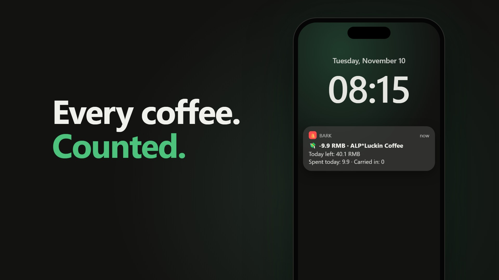
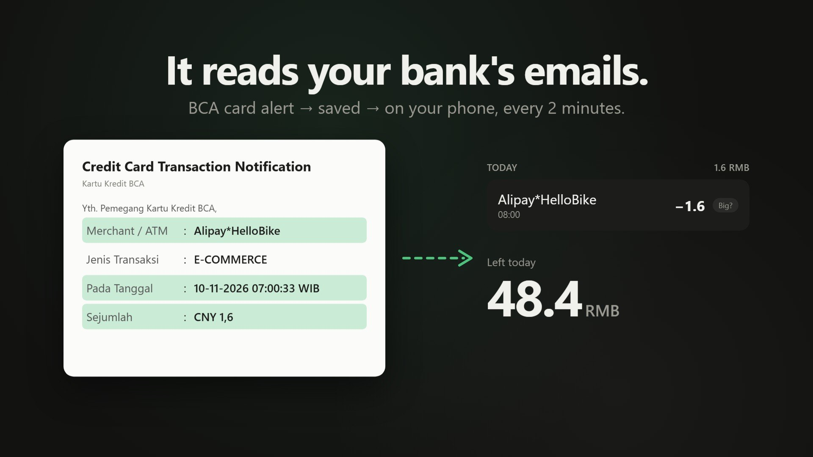
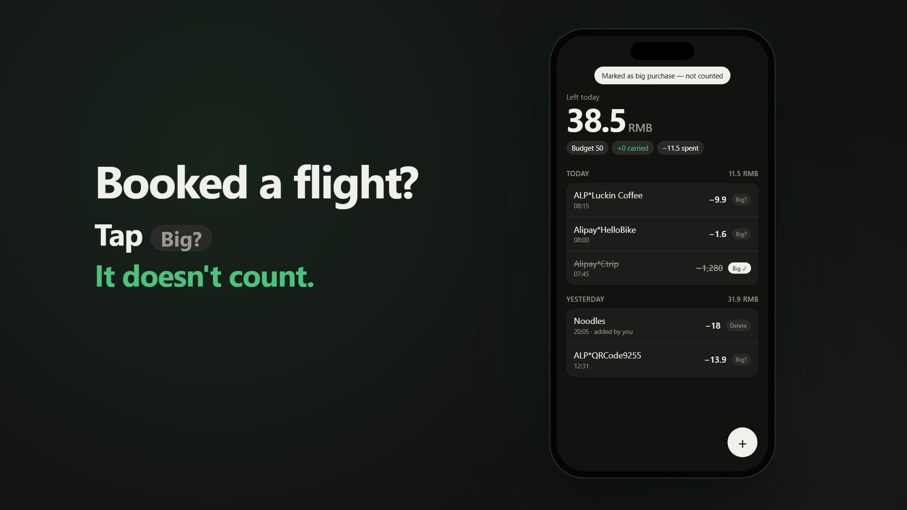

# Daily Budget

A 50 RMB-a-day budget that runs itself. Your bank already emails you every card purchase, so this reads those emails, keeps a rolling daily balance, and pings your iPhone after every purchase.



## How the budget works

- You get **50 RMB per day** (changeable).
- **Unspent money rolls over** to the next day.
- **Overspending comes out of** the next day.
- **Big one-off purchases** (a flight, rent) can be flagged with one tap so they don't count.

```
left today = 50 × (days since start, including today) − everything spent
```

| Day | Available | Spent | Carries over |
|---|---|---|---|
| Mon | 50 | 30 | +20 |
| Tue | 50 + 20 = 70 | 85 | −15 |
| Wed | 50 − 15 = 35 | | |

## How it works

```
BCA card email → Gmail → Supabase function (every 2 min) → database → Bark push to iPhone
                                                               ↑
                                     Home-screen web page (history, flag, add cash)
```



- **Reads BCA credit card notification emails** through the Gmail API (read-only). Amounts like `CNY 1,6` and Indonesian time zones (WIB/WITA/WIT) are handled; days are counted in China time.
- **Notifications through [Bark](https://github.com/Finb/Bark)**, a free iOS push app that works in China.
- **Home-screen web page** shows today's balance and history. Tap **Big?** to exclude a purchase, **+** to add cash spending or a refund.
- **Non-RMB card spending** (e.g. IDR) is saved but not counted.



## Stack

All on free tiers:

- **Supabase**: Postgres (balance math in SQL), two Edge Functions (Deno), `pg_cron` for the 2-minute check
- **Gmail API** with an OAuth refresh token
- **Bark** for iPhone notifications
- **Netlify** (or any static host) for the web page

## Project layout

```
supabase/
  migrations/…_init.sql      tables + get_balance() function
  cron.example.sql           schedules the Gmail check every 2 minutes
  functions/poll-gmail/      reads new BCA emails, saves them, sends Bark
  functions/api/             backend for the web page (token-protected)
  functions/_shared/parse.ts BCA email parser
web/                         home-screen page (index.html), privacy policy
scripts/get-gmail-token.mjs  one-time Google sign-in, saves the refresh token
tests/parse.test.ts          parser tests (node --test tests/parse.test.ts)
```

## Setup

About 30–40 minutes the first time. See **[SETUP.md](SETUP.md)** for step-by-step instructions.

Secrets live in `supabase/secrets.env`, which is git-ignored and never committed.

## Adapting it

Only `supabase/functions/_shared/parse.ts` is BCA-specific. For another bank, change the field labels and the sender address in `poll-gmail/index.ts`, and add a test with one of your emails.
